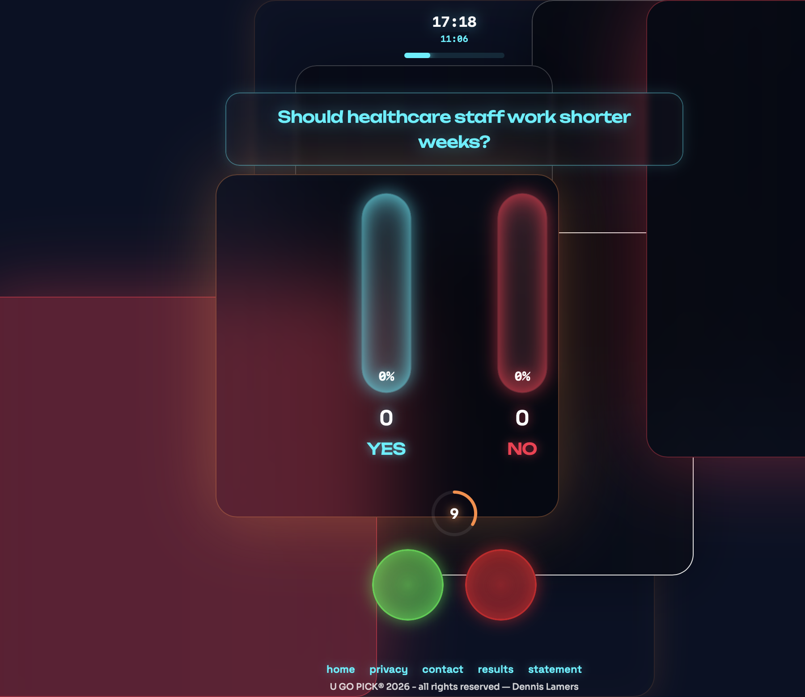

# UGOPICK---Pulse of Millions Public Sector Professionals

UGOPICK empowers public-sector professionals to make better-informed decisions, opening a global opportunity for AI-driven government innovation, scalable technology partnerships, and strategic acquisition by leading tech companies

**_What if the people who understand public-sector problems best could build the software to solve them?_**

**From a Real Problem to a Bigger Vision**

UGOPick is a digital tool **designed to help public-sector professionals** gather opinions, engage teams, and make decisions in a structured and transparent way.

That experience revealed an opportunity far bigger than the tool itself.

**What if AI enabled public-sector professionals to turn their own ideas into working digital solutions?**

**The Opportunity: Democratise Software Creation**

Public-sector organisations face thousands of specific challenges. The people closest to these problems often understand them best, yet turning their ideas into software can require specialist developers, substantial budgets, and lengthy procurement processes.

**AI is creating a new possibility**.

By combining domain expertise with AI-assisted development, public-sector professionals could identify problems, build prototypes, test solutions, and bring successful ideas closer to implementation.

The model is simple:

Domain expertise → Real problems → AI-assisted development → Working solutions

This is not about replacing developers or bypassing governance. It is about **empowering more people to participate in innovation, making experimentation more accessible, and helping organisations discover which ideas deserve investment**.

**Why It Matters**

Imagine unlocking the collective **problem-solving potential of millions of public-sector professionals**.

Instead of relying exclusively on traditional, top-down technology projects, organisations could enable the people who understand their challenges firsthand to help create the solutions.

The opportunity is to shorten the distance between identifying a problem and developing a practical response—while maintaining the security, privacy, accessibility, and accountability that public services demand.

UGOPick is an early example of this approach: a real product built by someone with deep domain experience rather than a traditional software development background.

**Beyond UGOPick**

**The ambition is to explore how this approach could evolve into a scalable model for public-sector digital innovation, potentially supported by AI, modern development platforms, strategic partnerships, and investment**.

The next step is to **validate the opportunity, explore practical applications, and discover how this model could complement existing technology ecosystems**.

**The Bigger Picture**

UGOPick began with a simple idea: **solve a practical problem in public-sector work**.

It has become the starting point for a bigger question:

_What if the next wave of public-sector innovation came from the people who understand its problems best—and AI gave them the power to build the solutions?_

**The product is small. The opportunity could be much bigger.**
**www.ugopick.com**

